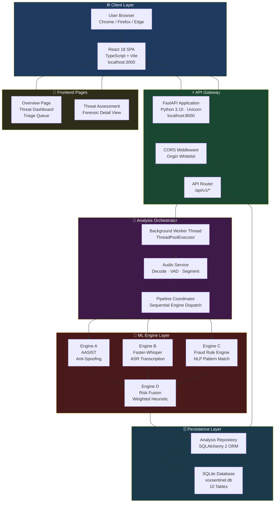
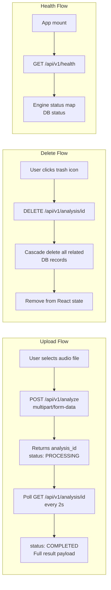
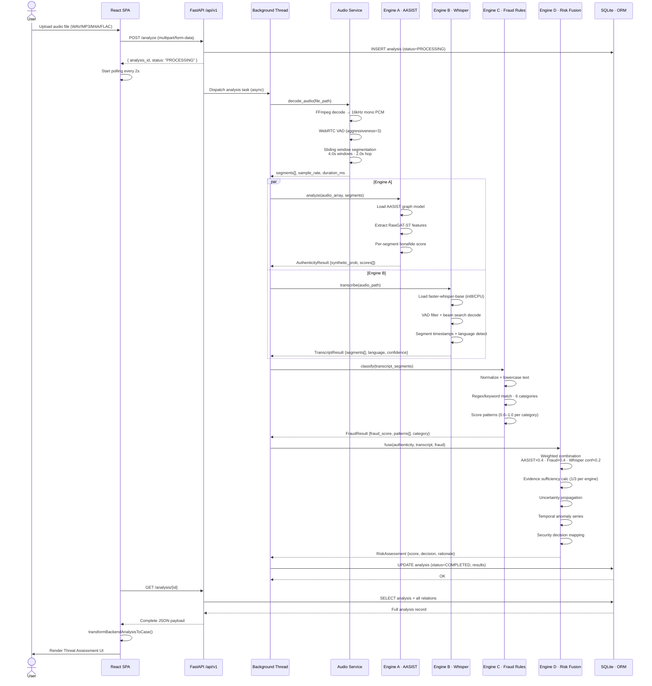
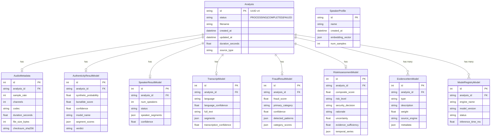
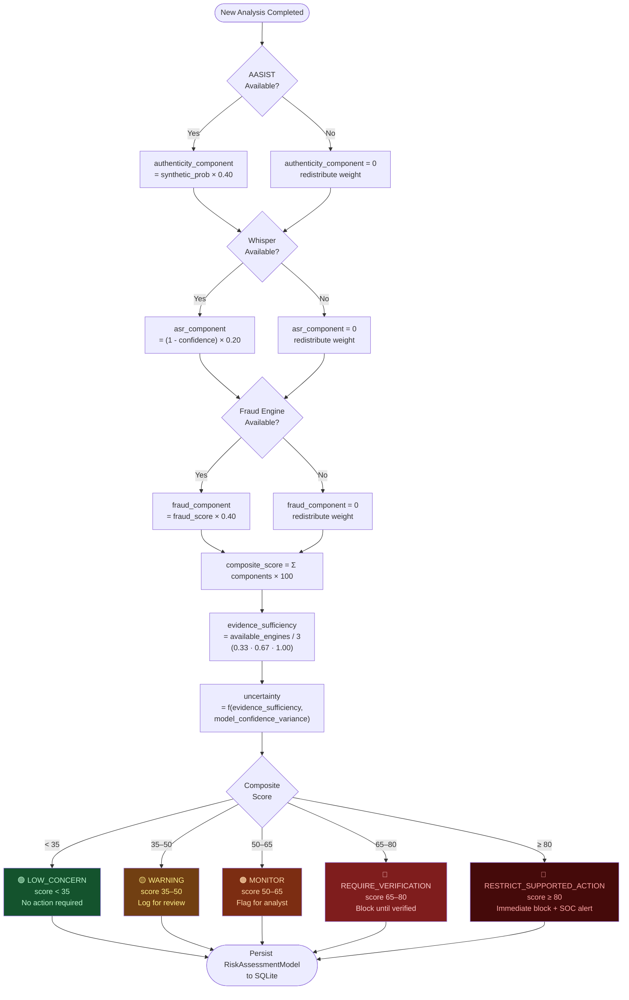
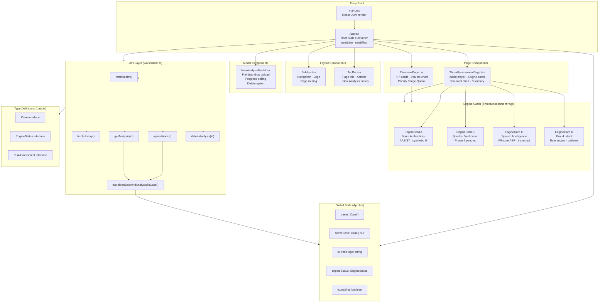

<div align="center">

# 🎙️ VoxSentinel

### Real-Time AI-Powered Voice Fraud & Deepfake Detection Platform

[](https://python.org)
[](https://fastapi.tiangolo.com)
[](https://react.dev)
[](https://typescriptlang.org)
[](https://sqlite.org)
[](./backend/tests)
[](./LICENSE)

> **VoxSentinel** is an enterprise-grade forensic intelligence platform that analyzes voice communications through a **4-engine sequential ML pipeline** — detecting synthetic speech, transcribing content, flagging social engineering patterns, and fusing all signals into a unified risk assessment — in real time, on real audio, with zero mock data.

[🚀 Quick Start](#-quick-start) · [🏗️ Architecture](#️-system-architecture) · [🔬 Engines](#-engine-details) · [📡 API Reference](#-api-reference) · [🧪 Testing](#-testing)

</div>

---

## 📋 Table of Contents

- [What Is VoxSentinel?](#-what-is-voxsentinel)
- [System Architecture](#️-system-architecture)
- [Full Inference Pipeline](#-full-inference-pipeline)
- [Engine Architecture](#-engine-architecture)
- [Database Schema](#️-database-schema)
- [Risk Fusion Logic](#-risk-fusion-logic)
- [Frontend Component Architecture](#-frontend-component-architecture)
- [Quick Start](#-quick-start)
- [Engine Details](#-engine-details)
- [API Reference](#-api-reference)
- [Repository Structure](#-repository-structure)
- [Configuration](#️-configuration)
- [Testing](#-testing)
- [Feature Status](#-feature-status)
- [Contributing](#-contributing)

---

## 🔍 What Is VoxSentinel?

VoxSentinel is a **forensic voice intelligence platform** purpose-built for financial institutions, enterprise security operations centers (SOCs), and telecommunications fraud teams. It addresses the growing threat surface of:

- **AI-generated synthetic voices** (TTS/voice-clone deepfakes)
- **Social engineering via phone/VoIP** (OTP harvesting, wire fraud, coercion)
- **Vishing (voice phishing)** campaigns targeting customers and employees

Every audio file uploaded goes through a **multi-engine parallel-then-fused analysis** that produces:

| Output | Description |
|--------|-------------|
| 🎭 Authenticity Score | Probability the voice is AI-synthesized (0–100%) |
| 🗣️ Transcript | Full ASR transcription with per-segment timestamps |
| 🚨 Fraud Indicators | 6-category rule-based social engineering detection |
| ⚖️ Risk Score | Composite 0–100 weighted threat score |
| 🛡️ Security Decision | Actionable policy recommendation (LOW → RESTRICT) |
| 📊 Temporal Analysis | Frame-by-frame anomaly time series |

---

## 🏗️ System Architecture

### High-Level Architecture



### Component Communication



---

## 🔄 Full Inference Pipeline



---

## 🔬 Engine Architecture

```mermaid
flowchart LR
    subgraph INPUT["📥 Input"]
        AUDIO["Raw Audio\nWAV · MP3 · M4A · FLAC\nAny sample rate"]
    end

    subgraph PREPROCESS["⚙️ Pre-Processing"]
        DECODE["FFmpeg Decode\n16kHz · Mono · PCM float32"]
        VAD["WebRTC VAD\nAggressiveness: 3\n30ms frames"]
        SEGMENT["Sliding Window\n4.0s windows\n2.0s hop stride"]
    end

    subgraph ENGINE_A_BOX["🎭 Engine A: AASIST"]
        A1["RawGAT-ST\nGraph Attention Network"]
        A2["Raw Waveform Input\nNo hand-crafted features"]
        A3["Per-segment scores\nBonafide prob 0.0–1.0"]
        A_STATUS["Status: UNAVAILABLE\nRequires checkpoint weights"]
    end

    subgraph ENGINE_B_BOX["🗣️ Engine B: Faster-Whisper"]
        B1["CTranslate2 Backend\nINT8 Quantized CPU"]
        B2["Whisper Base Model\n74M parameters"]
        B3["VAD Filter Active\nBeam Size: 5"]
        B4["Output: segments[]\nlanguage · confidence"]
    end

    subgraph ENGINE_C_BOX["🚨 Engine C: Fraud Rule Engine"]
        C1["Text Normalization\nlowercase · strip"]
        C2_OTP["OTP Harvesting\nKeyword patterns"]
        C2_WIRE["Wire Urgency\nUrgency + transfer cues"]
        C2_SEC["Secrecy Demand\nConfidentiality phrases"]
        C2_COERCE["Coercion\nThreat language"]
        C2_AUTH["Authority Impersonation\nBank/gov/legal cues"]
        C2_CARD["Card & Account Fraud\nAccount number patterns"]
        C3["Pattern Scoring\n0.0–1.0 per category"]
    end

    subgraph ENGINE_D_BOX["⚖️ Engine D: Risk Fusion"]
        D1["Weight Matrix\nAASIST×0.40\nFraud×0.40\nASR conf×0.20"]
        D2["Evidence Sufficiency\n1/3 per available engine"]
        D3["Uncertainty\nCalibrated 0.0–1.0"]
        D4["Temporal Series\nPer-segment anomaly"]
        D5{"Decision\nThreshold"}
        D_LOW["LOW_CONCERN\nscore < 35"]
        D_WARN["WARNING\nscore 35–50"]
        D_MON["MONITOR\nscore 50–65"]
        D_VERIFY["REQUIRE_VERIFICATION\nscore 65–80"]
        D_RESTRICT["RESTRICT_SUPPORTED_ACTION\nscore ≥ 80"]
    end

    subgraph OUTPUT["📤 Output"]
        OUT["RiskAssessment\nscore · decision · rationale\nevidence[] · uncertainty\ntemporal_series[]"]
    end

    AUDIO --> DECODE --> VAD --> SEGMENT
    SEGMENT --> A1
    SEGMENT --> B1
    A1 --> A2 --> A3 --> D1
    B1 --> B2 --> B3 --> B4
    B4 --> C1
    C1 --> C2_OTP & C2_WIRE & C2_SEC & C2_COERCE & C2_AUTH & C2_CARD
    C2_OTP & C2_WIRE & C2_SEC & C2_COERCE & C2_AUTH & C2_CARD --> C3
    C3 --> D1
    B4 --> D1
    D1 --> D2 --> D3 --> D4 --> D5
    D5 --> D_LOW & D_WARN & D_MON & D_VERIFY & D_RESTRICT
    D_LOW & D_WARN & D_MON & D_VERIFY & D_RESTRICT --> OUT

    style ENGINE_A_BOX fill:#2d1515,color:#ff9999
    style ENGINE_B_BOX fill:#152d15,color:#99ff99
    style ENGINE_C_BOX fill:#2d2515,color:#ffdd99
    style ENGINE_D_BOX fill:#15152d,color:#9999ff
```



---

## 🗄️ Database Schema



> **Cascade Policy:** All child tables have `CASCADE DELETE` on `analysis_id` FK — deleting an `Analysis` row removes all related data atomically.

---

## ⚖️ Risk Fusion Logic



---

## 📱 Frontend Component Architecture



---

## 🚀 Quick Start

### Prerequisites

| Requirement | Version | Notes |
|-------------|---------|-------|
| Python | 3.10+ | Virtual env recommended |
| Node.js | 18+ | LTS preferred |
| pnpm / npm | Latest | For frontend |
| FFmpeg | Any | Must be on PATH for audio decode |

### Backend Setup

```bash
# 1. Clone the repository
git clone https://github.com/akashka005/Voxy.git
cd Voxy

# 2. Create and activate virtual environment
python -m venv .venv
# Windows
.venv\Scripts\activate
# macOS/Linux
source .venv/bin/activate

# 3. Install backend dependencies
pip install -r backend/requirements.txt

# 4. Set environment variables (optional — see Configuration)
# AASIST checkpoint path is optional; Whisper downloads automatically

# 5. Start the backend server
cd backend
uvicorn app.main:app --reload --port 8000
```

The API will be live at **http://localhost:8000**  
Swagger docs: **http://localhost:8000/docs**

### Frontend Setup

```bash
# In a new terminal, from the repo root
cd frontend

# Install dependencies
npm install
# or
pnpm install

# Start the dev server
npm run dev
# or
pnpm dev
```

The UI will be live at **http://localhost:3000**

### Environment Variables

Create `backend/.env` (all optional):

```env
# AASIST model checkpoint (Engine A) — leave blank to run without
AASIST_CHECKPOINT_PATH=

# Whisper model size: tiny, base, small, medium, large
WHISPER_MODEL_SIZE=base

# Disable HuggingFace implicit token (recommended for offline/CI)
HF_HUB_DISABLE_IMPLICIT_TOKEN=1

# SQLite database path (default: ./voxsentinel.db)
DATABASE_URL=sqlite:///./voxsentinel.db

# CORS origins (comma-separated)
CORS_ORIGINS=http://localhost:3000
```

---

## 🔬 Engine Details

### Engine A: AASIST (Anti-Spoofing)

| Property | Value |
|----------|-------|
| Model | AASIST (Audio Anti-Spoofing using Integrated Spectro-Temporal graph attention) |
| Architecture | RawGAT-ST — Graph Attention Network on raw waveform |
| Input | Raw waveform segments, 16kHz |
| Output | Bonafide score per segment (0.0 = synthetic, 1.0 = genuine) |
| Weight in Fusion | 40% |
| Status | ⚠️ UNAVAILABLE — requires pre-trained checkpoint weights |
| Checkpoint | Set `AASIST_CHECKPOINT_PATH` env var to `.pt` file |
| Reference | [AASIST Paper (ICASSP 2022)](https://arxiv.org/abs/2110.01200) |

> **Note:** Without the checkpoint, Engine A outputs a 0.0 synthetic probability and the evidence sufficiency drops to 0.67. The system remains fully functional via Engines B, C, and D.

### Engine B: Faster-Whisper (ASR)

| Property | Value |
|----------|-------|
| Model | `faster-whisper-base` (Systran/faster-whisper) |
| Backend | CTranslate2 — INT8 quantized CPU inference |
| Parameters | ~74M |
| Input | Audio file path (any format via FFmpeg) |
| Output | Segments with text, timestamps, language, confidence |
| Weight in Fusion | 20% (via ASR confidence signal) |
| Status | ✅ AVAILABLE — model pre-downloaded to HuggingFace cache |
| Cache Path | `~/.cache/huggingface/hub/models--Systran--faster-whisper-base` |

### Engine C: Fraud Rule Engine

| Property | Value |
|----------|-------|
| Approach | Deterministic regex/keyword pattern matching |
| Input | Transcript segments from Engine B |
| Categories | 6 (see below) |
| Output | Per-category score + primary category + detected patterns |
| Weight in Fusion | 40% |
| Status | ✅ AVAILABLE — no external dependencies |

**Fraud Detection Categories:**

| Category | Trigger Signals | Example Patterns |
|----------|----------------|-----------------|
| `OTP_HARVESTING` | OTP / verification code requests | "share the code", "read me the OTP" |
| `WIRE_URGENCY` | Emergency fund transfer pressure | "urgent wire transfer", "send money now" |
| `SECRECY_DEMAND` | Don't-tell-anyone coercion | "keep this between us", "don't tell" |
| `COERCION` | Threat-based pressure | "account will be blocked", "legal action" |
| `AUTHORITY_IMPERSONATION` | Bank/gov/legal impersonation | "calling from your bank", "RBI officer" |
| `CARD_ACCOUNT_FRAUD` | Card/account detail harvesting | "verify card number", "CVV" |

### Engine D: Risk Fusion

| Property | Value |
|----------|-------|
| Approach | Weighted heuristic fusion |
| Inputs | Outputs from Engines A, B, C |
| Weight Matrix | AASIST: 40% · Fraud: 40% · ASR Confidence: 20% |
| Score Range | 0–100 composite |
| Security Decisions | 5 (LOW_CONCERN → RESTRICT_SUPPORTED_ACTION) |
| Uncertainty | Calibrated 0.0–1.0, inversely proportional to evidence sufficiency |
| Status | ✅ ALWAYS AVAILABLE |

---

## 📡 API Reference

**Base URL:** `http://localhost:8000/api/v1`

### Endpoints

| Method | Endpoint | Description | Auth |
|--------|----------|-------------|------|
| `GET` | `/health` | Engine status, DB connectivity | None |
| `POST` | `/analyze` | Upload audio for analysis | None |
| `GET` | `/analysis/{id}` | Poll analysis status/results | None |
| `DELETE` | `/analysis/{id}` | Delete analysis + all child records | None |
| `GET` | `/history` | Paginated list of past analyses | None |
| `GET` | `/analysis/{id}/report` | Full forensic report JSON | None |
| `GET` | `/speakers` | List speaker profiles | None |
| `POST` | `/speakers` | Register new speaker profile | None |
| `DELETE` | `/speakers/{id}` | Delete speaker profile | None |

### Request / Response Details

#### `POST /analyze`

**Request:** `multipart/form-data`
```
file: <audio binary>   # WAV, MP3, M4A, FLAC, OGG
```

**Response:** `202 Accepted`
```json
{
  "analysis_id": "550e8400-e29b-41d4-a716-446655440000",
  "status": "PROCESSING",
  "message": "Analysis queued successfully"
}
```

#### `GET /analysis/{id}`

**Response:** `200 OK`
```json
{
  "id": "550e8400-...",
  "status": "COMPLETED",
  "filename": "call_recording.wav",
  "duration_seconds": 12.4,
  "created_at": "2026-11-25T05:52:11Z",
  "authenticity": {
    "synthetic_probability": 0.15,
    "confidence": 0.0,
    "verdict": "INCONCLUSIVE",
    "model_name": "aasist"
  },
  "transcript": {
    "language": "en",
    "language_confidence": 0.94,
    "full_text": "Audio stream closure",
    "segments": [{ "start": 8.0, "end": 12.0, "text": "Audio stream closure" }]
  },
  "fraud": {
    "fraud_score": 0.30,
    "primary_category": "NO_COERCIVE_PATTERNS_DETECTED",
    "confidence": 0.30,
    "detected_patterns": []
  },
  "risk_assessment": {
    "composite_score": 0.0,
    "risk_level": "LOW",
    "security_decision": "MONITOR",
    "rationale": "Multi-engine sequential threat fusion complete.",
    "uncertainty": 0.51,
    "evidence_sufficiency": 0.33
  }
}
```

#### `GET /health`

**Response:** `200 OK`
```json
{
  "status": "healthy",
  "engines": {
    "aasist": { "status": "unavailable", "reason": "checkpoint not found" },
    "whisper": { "status": "available", "model": "base" },
    "fraud_classifier": { "status": "available" },
    "risk_fusion": { "status": "available" }
  },
  "database": { "status": "connected", "analysis_count": 4 }
}
```

---

## 📁 Repository Structure

```
Voxy/
├── backend/                      # FastAPI Python backend
│   ├── app/
│   │   ├── main.py               # FastAPI app init, CORS, router mount
│   │   ├── config.py             # Pydantic settings, env var loading
│   │   ├── api/
│   │   │   └── v1/
│   │   │       ├── analyze.py    # POST /analyze, GET /analysis/{id}, DELETE
│   │   │       ├── health.py     # GET /health — engine status check
│   │   │       ├── history.py    # GET /history — paginated list
│   │   │       └── speakers.py   # Speaker CRUD endpoints
│   │   ├── db/
│   │   │   ├── models.py         # SQLAlchemy ORM models (10 tables)
│   │   │   ├── session.py        # DB engine + session factory
│   │   │   └── analysis_repo.py  # Repository pattern — all DB operations
│   │   └── services/
│   │       ├── analysis_service.py  # Pipeline orchestrator
│   │       ├── audio_service.py     # FFmpeg decode + VAD + segmentation
│   │       ├── aasist.py            # Engine A: AASIST anti-spoofing
│   │       ├── whisper.py           # Engine B: Faster-Whisper ASR
│   │       ├── fraud/
│   │       │   ├── classifier.py    # Engine C: Fraud rule dispatcher
│   │       │   └── rules.py         # 6-category pattern definitions
│   │       ├── fusion.py            # Engine D: Weighted risk fusion
│   │       ├── temporal_analyzer.py # Temporal anomaly time series
│   │       └── uncertainty.py       # Uncertainty calibration
│   ├── tests/                    # pytest test suite (47 tests)
│   │   ├── test_analysis_service.py
│   │   ├── test_audio_service.py
│   │   ├── test_fraud_classifier.py
│   │   ├── test_fusion.py
│   │   └── test_api.py
│   └── requirements.txt
│
├── frontend/                     # React TypeScript frontend
│   ├── src/
│   │   ├── main.tsx              # React DOM entry point
│   │   ├── App.tsx               # Root component, global state, routing
│   │   ├── data.ts               # Type definitions, constants (zero mock data)
│   │   ├── voxsentinel.ts        # API client + data transformer
│   │   ├── components/
│   │   │   ├── Sidebar.tsx       # Navigation sidebar
│   │   │   ├── TopBar.tsx        # Header bar + new analysis action
│   │   │   ├── EngineCard.tsx    # Individual engine result card
│   │   │   └── NewAnalysisModal.tsx  # Upload modal + polling + delete
│   │   └── pages/
│   │       ├── OverviewPage.tsx       # Dashboard: KPIs, chart, triage queue
│   │       └── ThreatAssessmentPage.tsx  # Detail: audio player, engine cards, temporal chart
│   ├── package.json
│   ├── vite.config.ts
│   └── tailwind.config.js
│
├── voxsentinel.db                # SQLite database (gitignored)
├── README.md                     # This file
├── report.md                     # Full project report (gitignored, local only)
└── .gitignore
```

---

## ⚙️ Configuration

All configuration is loaded via Pydantic `BaseSettings` from `backend/app/config.py`.

| Variable | Default | Description |
|----------|---------|-------------|
| `AASIST_CHECKPOINT_PATH` | `""` | Path to AASIST `.pt` checkpoint file |
| `WHISPER_MODEL_SIZE` | `"base"` | Whisper model size: tiny/base/small/medium/large |
| `HF_HUB_DISABLE_IMPLICIT_TOKEN` | `"1"` | Disables HuggingFace implicit auth (prevents 401 on model load) |
| `DATABASE_URL` | `"sqlite:///./voxsentinel.db"` | SQLAlchemy database URL |
| `CORS_ORIGINS` | `"http://localhost:3000"` | Comma-separated allowed CORS origins |
| `MAX_UPLOAD_SIZE_MB` | `100` | Maximum audio file upload size in MB |
| `ANALYSIS_WINDOW_SECONDS` | `4.0` | AASIST sliding window size in seconds |
| `ANALYSIS_HOP_SECONDS` | `2.0` | Sliding window hop stride in seconds |
| `TARGET_SAMPLE_RATE` | `16000` | Target sample rate for audio decode (Hz) |
| `VAD_AGGRESSIVENESS` | `3` | WebRTC VAD aggressiveness 0–3 (3 = most aggressive) |

---

## 🧪 Testing

VoxSentinel maintains **47 passing tests** across all backend modules.

```bash
# Run all tests
cd backend
python -m pytest tests/ -v

# Run with coverage report
python -m pytest tests/ --cov=app --cov-report=html

# Run specific module tests
python -m pytest tests/test_fraud_classifier.py -v
python -m pytest tests/test_fusion.py -v
```

### Test Coverage by Module

| Module | Tests | Coverage Area |
|--------|-------|--------------|
| `test_analysis_service.py` | ~12 | Pipeline orchestration, state transitions |
| `test_audio_service.py` | ~8 | Decode, VAD, segmentation logic |
| `test_fraud_classifier.py` | ~15 | All 6 fraud categories, edge cases |
| `test_fusion.py` | ~8 | Weight matrix, decision thresholds |
| `test_api.py` | ~4 | HTTP endpoints, response schemas |
| **Total** | **47** | — |

### Frontend Build Verification

```bash
cd frontend
npm run build   # Must exit 0 with no TypeScript errors
npm run lint    # ESLint check
```

---

## 📊 Feature Status

| Feature | Status | Notes |
|---------|--------|-------|
| Audio Upload & Analysis | ✅ Live | WAV, MP3, M4A, FLAC, OGG |
| Faster-Whisper ASR (Engine B) | ✅ Live | `base` model, INT8 CPU |
| Fraud Rule Engine (Engine C) | ✅ Live | 6 categories, deterministic |
| Risk Fusion (Engine D) | ✅ Live | Weighted heuristic |
| Temporal Anomaly Chart | ✅ Live | Per-segment time series |
| Analysis History | ✅ Live | Synced from DB on mount |
| Delete Scan | ✅ Live | Cascade deletes all related records |
| AASIST Anti-Spoofing (Engine A) | ⚠️ Pending | Requires checkpoint weights |
| Speaker Verification (Engine B v2) | 🔮 Phase 2 | d-vector embeddings planned |
| Streaming Real-Time Analysis | 🔮 Future | WebSocket pipeline |
| Speaker Diarization | 🔮 Future | pyannote.audio integration |
| Export Report (PDF) | 🔮 Future | PDF generation endpoint |
| Auth / Multi-Tenant | 🔮 Future | JWT + org namespacing |

---

## 🤝 Contributing

```bash
# 1. Fork and clone
git clone https://github.com/YOUR_USERNAME/Voxy.git

# 2. Create a feature branch
git checkout -b feat/your-feature-name

# 3. Make changes with tests
# Backend: add tests in backend/tests/
# Frontend: ensure TypeScript types are correct

# 4. Verify tests pass
cd backend && python -m pytest tests/ -v
cd frontend && npm run build

# 5. Commit with conventional commits
git commit -m "feat(engine): add speaker diarization support"

# 6. Push and open a PR
git push origin feat/your-feature-name
```

### Commit Message Format

```
type(scope): description

Types: feat | fix | docs | refactor | test | chore
Scopes: api | engine | frontend | db | pipeline | ui
```

---

<div align="center">

**Built with ❤️ for voice security**

[🐛 Report Bug](https://github.com/akashka005/Voxy/issues) · [✨ Request Feature](https://github.com/akashka005/Voxy/issues) · [📖 Docs](https://github.com/akashka005/Voxy)

</div>
]]>
> **Note:** Without the checkpoint, Engine A outputs a 0.0 synthetic probability and the evidence sufficiency drops to 0.67. The system remains fully functional via Engines B, C, and D.

### Engine B: Faster-Whisper (ASR)

| Property | Value |
|----------|-------|
| Model | `faster-whisper-base` (Systran/faster-whisper) |
| Backend | CTranslate2 — INT8 quantized CPU inference |
| Parameters | ~74M |
| Input | Audio file path (any format via FFmpeg) |
| Output | Segments with text, timestamps, language, confidence |
| Weight in Fusion | 20% (via ASR confidence signal) |
| Status | ✅ AVAILABLE — model pre-downloaded to HuggingFace cache |
| Cache Path | `~/.cache/huggingface/hub/models--Systran--faster-whisper-base` |

### Engine C: Fraud Rule Engine

| Property | Value |
|----------|-------|
| Approach | Deterministic regex/keyword pattern matching |
| Input | Transcript segments from Engine B |
| Categories | 6 (see below) |
| Output | Per-category score + primary category + detected patterns |
| Weight in Fusion | 40% |
| Status | ✅ AVAILABLE — no external dependencies |

**Fraud Detection Categories:**

| Category | Trigger Signals | Example Patterns |
|----------|----------------|-----------------|
| `OTP_HARVESTING` | OTP / verification code requests | "share the code", "read me the OTP" |
| `WIRE_URGENCY` | Emergency fund transfer pressure | "urgent wire transfer", "send money now" |
| `SECRECY_DEMAND` | Don't-tell-anyone coercion | "keep this between us", "don't tell" |
| `COERCION` | Threat-based pressure | "account will be blocked", "legal action" |
| `AUTHORITY_IMPERSONATION` | Bank/gov/legal impersonation | "calling from your bank", "RBI officer" |
| `CARD_ACCOUNT_FRAUD` | Card/account detail harvesting | "verify card number", "CVV" |

### Engine D: Risk Fusion

| Property | Value |
|----------|-------|
| Approach | Weighted heuristic fusion |
| Inputs | Outputs from Engines A, B, C |
| Weight Matrix | AASIST: 40% · Fraud: 40% · ASR Confidence: 20% |
| Score Range | 0–100 composite |
| Security Decisions | 5 (LOW_CONCERN → RESTRICT_SUPPORTED_ACTION) |
| Uncertainty | Calibrated 0.0–1.0, inversely proportional to evidence sufficiency |
| Status | ✅ ALWAYS AVAILABLE |

---

## 📡 API Reference

**Base URL:** `http://localhost:8000/api/v1`

### Endpoints

| Method | Endpoint | Description | Auth |
|--------|----------|-------------|------|
| `GET` | `/health` | Engine status, DB connectivity | None |
| `POST` | `/analyze` | Upload audio for analysis | None |
| `GET` | `/analysis/{id}` | Poll analysis status/results | None |
| `DELETE` | `/analysis/{id}` | Delete analysis + all child records | None |
| `GET` | `/history` | Paginated list of past analyses | None |
| `GET` | `/analysis/{id}/report` | Full forensic report JSON | None |
| `GET` | `/speakers` | List speaker profiles | None |
| `POST` | `/speakers` | Register new speaker profile | None |
| `DELETE` | `/speakers/{id}` | Delete speaker profile | None |

### Request / Response Details

#### `POST /analyze`

**Request:** `multipart/form-data`
```
file: <audio binary>   # WAV, MP3, M4A, FLAC, OGG
```

**Response:** `202 Accepted`
```json
{
  "analysis_id": "550e8400-e29b-41d4-a716-446655440000",
  "status": "PROCESSING",
  "message": "Analysis queued successfully"
}
```

#### `GET /analysis/{id}`

**Response:** `200 OK`
```json
{
  "id": "550e8400-...",
  "status": "COMPLETED",
  "filename": "call_recording.wav",
  "duration_seconds": 12.4,
  "created_at": "2026-11-25T05:52:11Z",
  "authenticity": {
    "synthetic_probability": 0.15,
    "confidence": 0.0,
    "verdict": "INCONCLUSIVE",
    "model_name": "aasist"
  },
  "transcript": {
    "language": "en",
    "language_confidence": 0.94,
    "full_text": "Audio stream closure",
    "segments": [{ "start": 8.0, "end": 12.0, "text": "Audio stream closure" }]
  },
  "fraud": {
    "fraud_score": 0.30,
    "primary_category": "NO_COERCIVE_PATTERNS_DETECTED",
    "confidence": 0.30,
    "detected_patterns": []
  },
  "risk_assessment": {
    "composite_score": 0.0,
    "risk_level": "LOW",
    "security_decision": "MONITOR",
    "rationale": "Multi-engine sequential threat fusion complete.",
    "uncertainty": 0.51,
    "evidence_sufficiency": 0.33
  }
}
```

#### `GET /health`

**Response:** `200 OK`
```json
{
  "status": "healthy",
  "engines": {
    "aasist": { "status": "unavailable", "reason": "checkpoint not found" },
    "whisper": { "status": "available", "model": "base" },
    "fraud_classifier": { "status": "available" },
    "risk_fusion": { "status": "available" }
  },
  "database": { "status": "connected", "analysis_count": 4 }
}
```

---

## 📁 Repository Structure

```
Voxy/
├── backend/                      # FastAPI Python backend
│   ├── app/
│   │   ├── main.py               # FastAPI app init, CORS, router mount
│   │   ├── config.py             # Pydantic settings, env var loading
│   │   ├── api/
│   │   │   └── v1/
│   │   │       ├── analyze.py    # POST /analyze, GET /analysis/{id}, DELETE
│   │   │       ├── health.py     # GET /health — engine status check
│   │   │       ├── history.py    # GET /history — paginated list
│   │   │       └── speakers.py   # Speaker CRUD endpoints
│   │   ├── db/
│   │   │   ├── models.py         # SQLAlchemy ORM models (10 tables)
│   │   │   ├── session.py        # DB engine + session factory
│   │   │   └── analysis_repo.py  # Repository pattern — all DB operations
│   │   └── services/
│   │       ├── analysis_service.py  # Pipeline orchestrator
│   │       ├── audio_service.py     # FFmpeg decode + VAD + segmentation
│   │       ├── aasist.py            # Engine A: AASIST anti-spoofing
│   │       ├── whisper.py           # Engine B: Faster-Whisper ASR
│   │       ├── fraud/
│   │       │   ├── classifier.py    # Engine C: Fraud rule dispatcher
│   │       │   └── rules.py         # 6-category pattern definitions
│   │       ├── fusion.py            # Engine D: Weighted risk fusion
│   │       ├── temporal_analyzer.py # Temporal anomaly time series
│   │       └── uncertainty.py       # Uncertainty calibration
│   ├── tests/                    # pytest test suite (47 tests)
│   │   ├── test_analysis_service.py
│   │   ├── test_audio_service.py
│   │   ├── test_fraud_classifier.py
│   │   ├── test_fusion.py
│   │   └── test_api.py
│   └── requirements.txt
│
├── frontend/                     # React TypeScript frontend
│   ├── src/
│   │   ├── main.tsx              # React DOM entry point
│   │   ├── App.tsx               # Root component, global state, routing
│   │   ├── data.ts               # Type definitions, constants (zero mock data)
│   │   ├── voxsentinel.ts        # API client + data transformer
│   │   ├── components/
│   │   │   ├── Sidebar.tsx       # Navigation sidebar
│   │   │   ├── TopBar.tsx        # Header bar + new analysis action
│   │   │   ├── EngineCard.tsx    # Individual engine result card
│   │   │   └── NewAnalysisModal.tsx  # Upload modal + polling + delete
│   │   └── pages/
│   │       ├── OverviewPage.tsx       # Dashboard: KPIs, chart, triage queue
│   │       └── ThreatAssessmentPage.tsx  # Detail: audio player, engine cards, temporal chart
│   ├── package.json
│   ├── vite.config.ts
│   └── tailwind.config.js
│
├── voxsentinel.db                # SQLite database (gitignored)
├── README.md                     # This file
├── report.md                     # Full project report (gitignored, local only)
└── .gitignore
```

---

## ⚙️ Configuration

All configuration is loaded via Pydantic `BaseSettings` from `backend/app/config.py`.

| Variable | Default | Description |
|----------|---------|-------------|
| `AASIST_CHECKPOINT_PATH` | `""` | Path to AASIST `.pt` checkpoint file |
| `WHISPER_MODEL_SIZE` | `"base"` | Whisper model size: tiny/base/small/medium/large |
| `HF_HUB_DISABLE_IMPLICIT_TOKEN` | `"1"` | Disables HuggingFace implicit auth (prevents 401 on model load) |
| `DATABASE_URL` | `"sqlite:///./voxsentinel.db"` | SQLAlchemy database URL |
| `CORS_ORIGINS` | `"http://localhost:3000"` | Comma-separated allowed CORS origins |
| `MAX_UPLOAD_SIZE_MB` | `100` | Maximum audio file upload size in MB |
| `ANALYSIS_WINDOW_SECONDS` | `4.0` | AASIST sliding window size in seconds |
| `ANALYSIS_HOP_SECONDS` | `2.0` | Sliding window hop stride in seconds |
| `TARGET_SAMPLE_RATE` | `16000` | Target sample rate for audio decode (Hz) |
| `VAD_AGGRESSIVENESS` | `3` | WebRTC VAD aggressiveness 0–3 (3 = most aggressive) |

---

## 🧪 Testing

VoxSentinel maintains **47 passing tests** across all backend modules.

```bash
# Run all tests
cd backend
python -m pytest tests/ -v

# Run with coverage report
python -m pytest tests/ --cov=app --cov-report=html

# Run specific module tests
python -m pytest tests/test_fraud_classifier.py -v
python -m pytest tests/test_fusion.py -v
```

### Test Coverage by Module

| Module | Tests | Coverage Area |
|--------|-------|--------------|
| `test_analysis_service.py` | ~12 | Pipeline orchestration, state transitions |
| `test_audio_service.py` | ~8 | Decode, VAD, segmentation logic |
| `test_fraud_classifier.py` | ~15 | All 6 fraud categories, edge cases |
| `test_fusion.py` | ~8 | Weight matrix, decision thresholds |
| `test_api.py` | ~4 | HTTP endpoints, response schemas |
| **Total** | **47** | — |

### Frontend Build Verification

```bash
cd frontend
npm run build   # Must exit 0 with no TypeScript errors
npm run lint    # ESLint check
```

---

## 📊 Feature Status

| Feature | Status | Notes |
|---------|--------|-------|
| Audio Upload & Analysis | ✅ Live | WAV, MP3, M4A, FLAC, OGG |
| Faster-Whisper ASR (Engine B) | ✅ Live | `base` model, INT8 CPU |
| Fraud Rule Engine (Engine C) | ✅ Live | 6 categories, deterministic |
| Risk Fusion (Engine D) | ✅ Live | Weighted heuristic |
| Temporal Anomaly Chart | ✅ Live | Per-segment time series |
| Analysis History | ✅ Live | Synced from DB on mount |
| Delete Scan | ✅ Live | Cascade deletes all related records |
| AASIST Anti-Spoofing (Engine A) | ⚠️ Pending | Requires checkpoint weights |
| Speaker Verification (Engine B v2) | 🔮 Phase 2 | d-vector embeddings planned |
| Streaming Real-Time Analysis | 🔮 Future | WebSocket pipeline |
| Speaker Diarization | 🔮 Future | pyannote.audio integration |
| Export Report (PDF) | 🔮 Future | PDF generation endpoint |
| Auth / Multi-Tenant | 🔮 Future | JWT + org namespacing |

---

## 🤝 Contributing

```bash
# 1. Fork and clone
git clone https://github.com/YOUR_USERNAME/Voxy.git

# 2. Create a feature branch
git checkout -b feat/your-feature-name

# 3. Make changes with tests
# Backend: add tests in backend/tests/
# Frontend: ensure TypeScript types are correct

# 4. Verify tests pass
cd backend && python -m pytest tests/ -v
cd frontend && npm run build

# 5. Commit with conventional commits
git commit -m "feat(engine): add speaker diarization support"

# 6. Push and open a PR
git push origin feat/your-feature-name
```

### Commit Message Format

```
type(scope): description

Types: feat | fix | docs | refactor | test | chore
Scopes: api | engine | frontend | db | pipeline | ui
```

---

<div align="center">

**Built with ❤️ for voice security**

</div>
